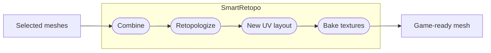

# (Not So) Smart Retopo

## A retopology plugin for Smart People

The repo implements a Blender extension that turns arbitrary meshes into low-poly, textured game-ready meshes.

Selected meshes are combined together, then automatically retopologized, or you can provide your own low-poly mesh.
A new UV layout is generated (or the low-poly's existing UVs are kept), then new PBR textures are baked from the old geometry onto the new model using Cycles.



The extension has an interactive UI but is also built to be executed through automation.

The plugin is not terribly smart yet but it does have sensible defaults! Please bring your own intelligence when using this plugin.

## Usage

See [`smart_retopo/README.md`](smart_retopo/README.md).

## Development

### Repo layout

| Path | |
|---|---|
| `smart_retopo/` | The extension package (`blender_manifest.toml`, operator, panel, `core/` pipeline package (one module per step), `cli.py` headless runner) |
| `tests/test_pipeline.py` | End-to-end test: builds a scene, runs the operator, asserts on mesh/UVs/baked maps |
| `scripts/build.sh` | Builds the installable zip into `dist/` |

### Environment

```sh
# Run the test (Blender on PATH, or set BLENDER)
blender -b --factory-startup -P tests/test_pipeline.py
#   ...or with the bpy wheel:  pip install bpy && python tests/test_pipeline.py

# Lint (same check as CI)
ruff check .

# Check the manifest version (add a tag, e.g. v0.2.0, to check it matches)
python3 tests/ci/check_version.py

# Build the extension zip
./scripts/build.sh            # -> dist/smart_retopo-<version>.zip

# Live-develop (macOS): symlink the package into Blender's user extensions repo.
# Run from the repo root; set BV to your Blender version (e.g. 5.2).
BV=5.2
mkdir -p "$HOME/Library/Application Support/Blender/$BV/extensions/user_default"
ln -sfn "$(git rev-parse --show-toplevel)/smart_retopo" \
  "$HOME/Library/Application Support/Blender/$BV/extensions/user_default/smart_retopo"
# Then in Blender: Preferences > Get Extensions > Refresh, and enable "Smart Retopo".
```

Headless run:

```sh
blender -b -P smart_retopo/cli.py -- -i in.glb -o out.glb --faces 4000 --report result.json
```

## Releasing

Releases are automated with [release-please](https://github.com/googleapis/release-please):

1. Merge PRs to `main` with [Conventional Commit](https://www.conventionalcommits.org/) titles (`feat: …`, `fix: …`). CI enforces this.
2. release-please keeps a `chore(main): release X.Y.Z` PR open with the version bump and `CHANGELOG.md`.
3. Merging that PR tags `vX.Y.Z`. The release workflow then builds, tests and attests the zip, uploads it with `SHA256SUMS`, and publishes the GitHub Release.
4. The release workflow then calls `pages.yml`, which updates the Blender extension repositories on GitHub Pages. Blender users subscribed to them get the update.

### Extension repositories (update channels)

| Channel | URL | Contains |
|---|---|---|
| Stable | `https://magnopus.github.io/BlenderSmartRetopo/index.json` | The newest `vX.Y.Z` release |
| Beta | `https://magnopus.github.io/BlenderSmartRetopo/beta/index.json` | The newest release or release candidate (`vX.Y.Z-rc.N`) |

`scripts/extension_channels.py` picks the releases, and `pages.yml` runs after each release, daily, and on demand. A Blender listing holds one version per extension, so each channel serves exactly one zip.

- **Release candidate:** merge a commit to `main` with the footer `Release-As: 0.3.0-rc.1`. The Release PR then proposes `0.3.0-rc.1`, and merging it publishes a GitHub pre-release into the beta channel only. Ship the final version the same way (`Release-As: 0.3.0`), so release-please doesn't pick the next version from the candidate.
- **Pulling a release:** releases are immutable, so don't re-upload. On GitHub, edit the release and tick **Set as a pre-release**, then run **Actions > Extension repository > Run workflow** (or wait for the daily run). Both channels fall back to the previous release. To pull a release candidate, delete its GitHub release. Then ship a fixed patch.
- **One-time setup:** Settings > Pages > Source: **GitHub Actions**.

Never edit the version in `blender_manifest.toml` by hand. While on 0.x, breaking changes bump the minor version.

Verify a downloaded release:

```sh
sha256sum -c SHA256SUMS
gh attestation verify smart_retopo-X.Y.Z.zip -R magnopus-opensource/BlenderSmartRetopo
```

Releases v0.1.0 and v0.1.1 were built before the repo moved from the `magnopus` org, so verify those with `-R magnopus/BlenderSmartRetopo`.

Supports Blender 5.0 and later. CI tests 5.0 and 5.2 LTS.

## License

Copyright 2026 Magnopus LLC.

Smart Retopo is free software, licensed under the [GNU General Public License v3.0 or later](LICENSE) (`GPL-3.0-or-later`), the same license family as Blender. Anyone you give the extension to receives the same rights: to run, study, modify and share it, provided derived versions stay under the GPL.

- `LICENSE` and `LICENSES/GPL-3.0-or-later.txt` hold the full license text, and `smart_retopo/LICENSE` ships inside every release zip.
- Every file carries an SPDX header, or is covered by `REUSE.toml`. CI runs [`reuse lint`](https://reuse.software/) to keep it that way, so add this header to new source files:

  ```python
  # SPDX-FileCopyrightText: 2026 Magnopus LLC
  # SPDX-License-Identifier: GPL-3.0-or-later
  ```
