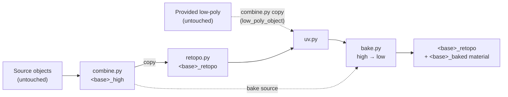

# Architecture

Smart Retopo turns selected objects into one low-poly, UV-mapped, textured mesh in four steps. The low-poly is generated by QuadriFlow, or provided by the user (`low_poly_object`). Every step lives in `smart_retopo/core/`, and none of them depend on the UI.

`core/pipeline.py:smart_retopo(objects, settings, progress)` runs the steps and returns a `RetopoResult`. Its shape is in [`result.schema.json`](result.schema.json).

## Entry points

All three entry points call the same `core.smart_retopo`.

| Entry point | File | Settings come from | Result goes to |
|---|---|---|---|
| UI button / Object menu | `operators.py` (`invoke`) | Panel values on `scene.smart_retopo`, unless a property is explicitly set | Info report |
| Python / MCP: `bpy.ops.object.smart_retopo(...)` | `operators.py` (`execute`) | Only the arguments passed, otherwise the defaults. **Panel values are ignored.** | `window_manager["smart_retopo_last_result"]` (JSON string) |
| Headless CLI: `blender -b -P smart_retopo/cli.py -- ...` | `cli.py` | Flags, then `--settings-json` merged on top | `SMART_RETOPO_RESULT: {json}` on stdout, optional `--report` file, exit code 1 on failure |

The operator and the panel share one property definition, the `SmartRetopoProps` mixin in `props.py`. `to_settings()` maps it onto the `RetopoSettings` dataclass in `core/settings.py`. A new setting therefore needs adding in both places.

## Steps

**1. Combine (`combine.py`).** Each source is evaluated through the depsgraph, so modifiers are applied and curves and text are converted. Its mesh is copied, world transforms are baked in, and normals are flipped for negative scale. Material slots are copied onto the mesh, including object-linked materials. Then everything is joined into `<base>_high`. The source objects are never modified.

**2. Retopologize (`retopo.py`), working on a copy named `<base>_retopo`.**

1. Cleanup: merge by distance, remove loose vertices, recalculate normals.
2. Voxel pre-pass. With `voxel_mode=AUTO`, it runs when there are several sources or the mesh isn't manifold. QuadriFlow needs a manifold mesh with consistent normals, and the voxel shell also fuses intersecting parts.
3. QuadriFlow to `target_faces`. If QuadriFlow fails and no voxel pass ran, it voxel-remeshes and retries once. `NEVER` disables the retry.

**2b. Provided low-poly.** With `low_poly_object` set, step 2 is replaced by `combine_meshes([low_poly])`: an evaluated, world-space copy named `<base>_retopo` that keeps its UV maps. QuadriFlow, the voxel pass, cleanup and `smooth_shading` are skipped. The low-poly is removed from the sources if it was selected too, and the user's object is never modified. `_resolve_low_poly` validates the settings before anything is created.

**3. UVs (`uv.py`).** `uv_mode=GENERATE` (default): removes all UV layers, adds `UVMap`, runs Smart UV Project or Lightmap Pack, then packs the islands with rotation. `uv_mode=EXISTING` (only valid with a provided low-poly): `use_existing_uvs` makes the render UV map the active layer, which is the one the bake writes through, keeps the other layers, fails if there are none, and adds a warning if UVs fall outside 0–1.

**4. Bake (`bake.py`).** Cycles selected-to-active from `_high` to `_retopo`, one image per map:

| Map | How | Colour space |
|---|---|---|
| BASE_COLOR, ROUGHNESS, METALLIC | **Emission swap.** Each source material's Principled input is temporarily routed through an Emission shader, then an `EMIT` bake runs. | sRGB / Non-Color / Non-Color |
| NORMAL | Native `NORMAL` bake, tangent space | Non-Color |
| AO | Native `AO` bake | Non-Color |
| EMISSION | Native `EMIT` bake | sRGB |

Images are saved to `output_dir`, or packed when it's empty. Then they're wired into a new Principled material, `<base>_baked`. AO is baked but **not** wired in, because Principled has no AO input.

## Behaviour that's easy to break

- **Why the emission swap.** Cycles' `DIFFUSE` color pass multiplies by `(1 - metallic)`, so metals bake black. Rendering the input socket as emission captures the raw value whatever the lighting. Every swap is undone in a `finally`, even if a bake fails.
- **Sources are hidden during the bake.** The originals sit exactly on top of `_high` and would occlude the AO rays. A provided low-poly is hidden too, because it sits exactly on its `_retopo` copy, and it follows `hide_sources` afterwards. `pipeline.py` hides them for the bake, then restores their visibility. If this is removed, AO comes out almost black: a mean of 0.04 instead of 0.8 in the test scene.
- **Auto cage.** When `cage_extrusion` or `max_ray_distance` is 0, they're set from the high-poly's bounding-box diagonal: 1% and 5%. Thin or huge assets may need explicit values, and so may a provided low-poly that sits further from the surface than QuadriFlow output would.
- **Empty material slots** on the sources get a default Principled material, so socket bakes still produce values.
- **Cleanup on failure.** If any step raises, `_high` and `_retopo` are removed, so a failed run doesn't litter the scene. On success, `_high` is removed unless `keep_high_poly` is set, and the sources are hidden if `hide_sources` is set.
- **Render settings** are saved and restored around the bake: engine, samples and device.
- **Context.** Operators run under `bpy.context.temp_override(...)` or after `_make_active()`, and in object mode. Keep that pattern, because the code has to work headless (`blender -b`) where there's no window.
- **QuadriFlow from Python is blocking.** It runs synchronously when called from a script. The UI operator therefore blocks too, and there's no modal or job version yet.

## Packaging

- `smart_retopo/blender_manifest.toml` is the only place the version and metadata live; there's no `bl_info`. release-please updates `version` through a TOML updater.
- `blender --command extension build` builds the zip, and `[build] paths_exclude_pattern` keeps `__pycache__` out. The zip includes `LICENSE`.
- The `core/` package and `cli.py` import nothing from the UI, so automation can use them without registering the add-on: `cli.py` adds the repo to `sys.path`.
